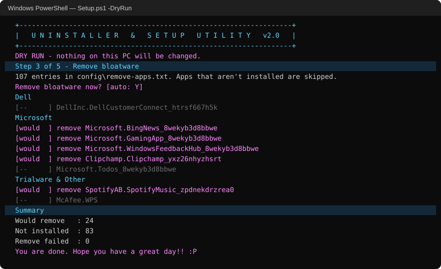

# Uninstaller & Setup Utility: Windows Bloatware Removal & New PC Setup Script

**A free, open-source USB tool that removes OEM bloatware from new Dell, HP and Lenovo PCs, cleans out Windows 11/10 junk apps, then installs your standard apps, one Y/N step at a time.** Built by an IT tech for PC deployments, not for tweaking your own gaming rig.

[](https://github.com/davidlamma/pc-setup-utility/releases/latest)


[](LICENSE)



**[⬇ Download the latest release](https://github.com/davidlamma/pc-setup-utility/releases/latest)** · **[Full guide on PC-BUILT Fixbook](https://pc-built.com/fixbook/posts/bloatware-uninstall-script/)**

---

## What it does

```
1  Repair winget      fixes the broken winget that ships on a lot of new PCs
2  Inventory          saves a list of every installed app + its ID
3  Remove bloatware   Dell / HP / Lenovo / Microsoft / trialware, from a list you control
4  Install apps       Chrome, Firefox, 7-Zip, Adobe Reader... whatever you list
5  Run installers     any .exe / .msi you drop in the Installs folder (Ninite, Office...)
```

Answer **N** to skip any step. Every run is logged, and you get a removed / not installed / failed summary at the end.

## Features

- **Removes OEM bloatware:** HP Wolf Security, HP Support Assistant, Dell SupportAssist / Digital Delivery, Lenovo Vantage / Companion, McAfee, Norton, CyberLink and 100+ more
- **Cleans out Windows 11 / 10 junk:** Xbox apps, Copilot, Clipchamp, Bing News & Weather, Solitaire, Feedback Hub, Teams personal, Candy Crush, Spotify
- **Deprovisions Store apps**, so they don't reinstall themselves for the next user who signs in
- **Dry-run mode** checks what's really installed on *this* PC and changes nothing
- **Works with current winget.** Newer winget's [ID format change](#why-v20-old-winget-scripts-silently-stopped-working) broke most bloatware scripts; this one handles both formats
- **No coding to customize.** Edit plain-text lists, never the script
- **Safe defaults.** Never touches Windows Security, Edge, the Store or Windows Update components
- **Runs from a USB stick.** Double-click, approve admin, answer Y/N. Unattended mode too (`-Auto`)

## Quick start

1. **[Download the latest release](https://github.com/davidlamma/pc-setup-utility/releases/latest)** (Source code .zip) and unzip it onto a USB stick.
2. *(Optional)* Put extra installers in the `Installs` folder, such as a Ninite bundle or Office.
3. On the PC, double-click **`Run Setup.bat`** and approve the admin prompt.
4. Answer Y or N at each step. Restart when it's done.

See what it would do first with a **dry run**, which changes nothing:

```powershell
powershell -ExecutionPolicy Bypass -File .\Setup.ps1 -DryRun
```

| Switch | What it does |
|---|---|
| *(none)* | Interactive. Asks Y/N before every step |
| `-DryRun` | Reports what would be removed or installed on this PC. Changes nothing |
| `-Auto` | Answers Yes to every step (unattended) |

## Make it yours

Everything it removes or installs lives in plain text files:

| File | What it controls |
|---|---|
| `config/remove-apps.txt` | Bloatware to remove. One winget ID per line, or `name: Display Name`. Put `#` in front of a line to switch it off. |
| `config/install-apps.txt` | Apps to install from the internet with winget (`winget search <app>` finds the IDs). |
| `config/winget-settings.json` | winget settings copied onto the PC during step 1. |
| `Installs/` | Installers to copy to `C:\SetupKit` and run one at a time. |
| `banner.txt` | The banner at the top. Put your shop's name on it. |

**Finding new bloatware:** run step 2 (Inventory) on a model you haven't seen before. It saves `logs/inventory-<PC>-<date>.txt` with every app's ID. Paste the junk IDs into `remove-apps.txt` (either winget format works), and the next machine gets them removed too. That loop is how the original list was built.

## What it removes by default

| Vendor | Apps |
|---|---|
| **Dell** | Customer Connect, Digital Delivery, My Dell |
| **HP** | Support Assistant, Wolf Security + Console, Sure Run, Sure Recover, Easy Clean, JumpStart, QuickDrop, Power Manager, Audio Center, Privacy Settings, Connection Optimizer, Notifications, Performance Advisor, System Event Utility, Documentation |
| **Lenovo** | Vantage Service, Companion, Smart Meeting, Smart Appearance, Hotkeys utility, Lenovo Now, CyberLink Power2Go / PowerDVD, Elevoc mic settings |
| **Microsoft** | Copilot, Bing News & Weather, Xbox apps & Game Bar, Solitaire, Feedback Hub, Maps, Mixed Reality Portal, Phone Link, Clipchamp, Teams (personal + machine-wide installer), Skype, Mail & Calendar, Sticky Notes, Office hub, Journal, To Do, Whiteboard, consumer Office/OneNote trials |
| **Trialware & other** | McAfee LiveSafe / WPS / WebAdvisor, Norton, Candy Crush, March of Empires, Spotify, Dropbox OEM, Dolby Access |

**Off by default** (uncomment to remove): OneDrive, new Outlook, Snipping Tool, Quick Assist, Microsoft Update Health Tools.
**Never removed:** Windows Security, Microsoft Edge, Microsoft Store, Windows Update components.

## Why v2.0: old winget scripts silently stopped working

Newer winget lists apps it didn't install with **source-prefixed IDs**:

```text
Microsoft Clipchamp    MSIX\Clipchamp.Clipchamp_4.6.10420.0_x64__yxz26nhyzhsrt
AMD Install Manager    ARP\Machine\X64\{547DB986-CAD5-49AA-A684-E1600CADA4D7}
```

So the classic `winget uninstall --id Clipchamp.Clipchamp_yxz26nhyzhsrt` now returns **"No installed package found matching input criteria"** even when the app is installed. On winget 1.29, the v1.5 list of this tool matched **zero** apps on a PC that had two dozen of them.

v2.0 finds apps itself instead of trusting winget's ID match. Store apps go through `Get-AppxPackage` / `Remove-AppxPackage` (plus deprovisioning). Classic programs are looked up in the registry's uninstall keys and passed to winget as `ARP\<scope>\<key>`, with a fallback to the bare ID on old winget builds. The logic is in `Find-App` in [`Setup.ps1`](Setup.ps1).

Full write-up and manual fixes: **[winget "No installed package found": why it happens and how to fix it](https://pc-built.com/fixbook/posts/winget-no-installed-package-found/)**

## FAQ

**Is it safe to run?** It only removes what's in your list, it never touches Windows Security or core Windows components, and `-DryRun` shows exactly what it would do first. It's meant for **fresh machines**. On a PC someone already uses, or a gaming PC (it removes the Xbox apps), read the list first.

**Does it work on Windows 10?** Yes, Windows 10 and 11 with winget (App Installer). Step 1 repairs winget if it's there but broken.

**How is this different from other Windows debloaters?** Most debloaters target enthusiasts tuning their own PC: privacy tweaks, UI changes, services. This one targets **techs and MSPs setting up OEM machines for someone else**. It's conservative, list-driven and logged, and it does the "install the standard apps" half of the job too.

**Will the bloatware come back?** Removed Store apps are deprovisioned, so new user profiles won't get them. A major Windows feature update can occasionally bring a few back. Run it again.

**Can I use it at my company / MSP?** Yes. It's MIT licensed. Rename it, rebrand the banner, ship it.

## Why this exists

I built this in 2024 while doing PC deployments for a small managed IT shop that had no RMM and no imaging. Every new machine got set up by hand: click through Dell, HP or Lenovo's pre-loaded apps one at a time, uninstall McAfee, then download Chrome and Reader again.

So I put a batch file on the flash drive. It started as about 60 lines in v0.8 and went through five versions as new bloatware turned up on new hardware. The originals are preserved as they were in [`archive/`](archive/v1-cnsi-usb). v2.0 is a clean rewrite in PowerShell that keeps the same step-by-step flow.

## Version history

| Version | What changed |
|---|---|
| **v2.0** | PowerShell rewrite. Works with newer winget, whose ID format change had made the old lists quietly match nothing. Store apps are removed natively and deprovisioned for new users. Also: lists moved to config files, requests admin rights itself, dry-run and auto modes, logging, a removed / skipped / failed summary, safer defaults |
| v1.5 | Uses the stick's own drive letter (`%~d0`) instead of a hard-coded `D:`/`E:`, system info header, about 120 apps |
| v1.4 | Beta that expanded the HP and Lenovo coverage (about 110 apps) |
| v1.3 | Step that reinstalls winget, plus a settings.json push; list grows to about 90 apps |
| v1.0 | Y/N prompt at each step, a banner with instructions, the list grouped by vendor |
| v0.8 | First batch file: about 55 winget uninstalls, then Ninite and Reader copied from the flash drive |

## Related guides

- [Free bloatware removal script for Windows 11 & 10: full guide](https://pc-built.com/fixbook/posts/bloatware-uninstall-script/)
- [Winget & PowerShell commands to remove bloatware by vendor](https://pc-built.com/fixbook/posts/winget-remove-bloatware/)
- [Fix or reinstall winget](https://pc-built.com/fixbook/posts/winget-fix-reinstall/)
- [Bulk-install apps with Ninite](https://pc-built.com/fixbook/posts/ninite-bulk-install/)

## License

MIT. Use it, change it, put your own name on the banner. If it saves you an afternoon, that's the whole point. ⭐ Star the repo if it did.

*by [David Lamma](https://github.com/davidlamma) · more IT fixes at [PC-BUILT Fixbook](https://pc-built.com/fixbook/)*
